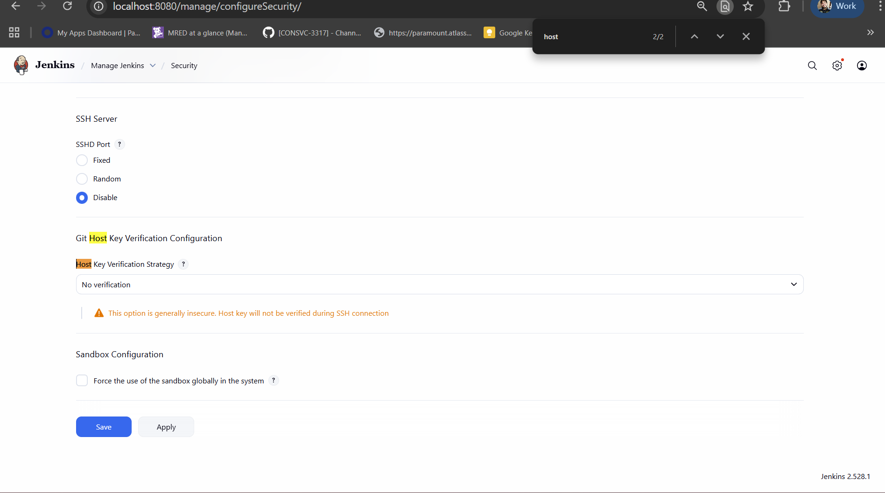
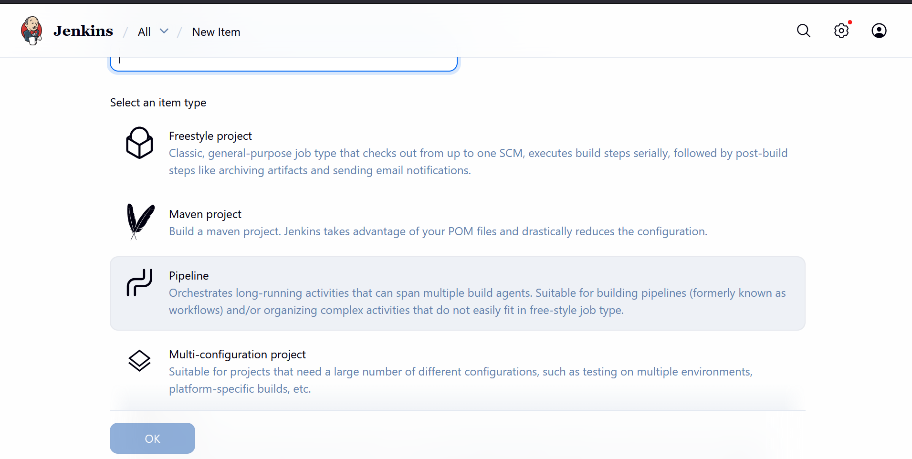
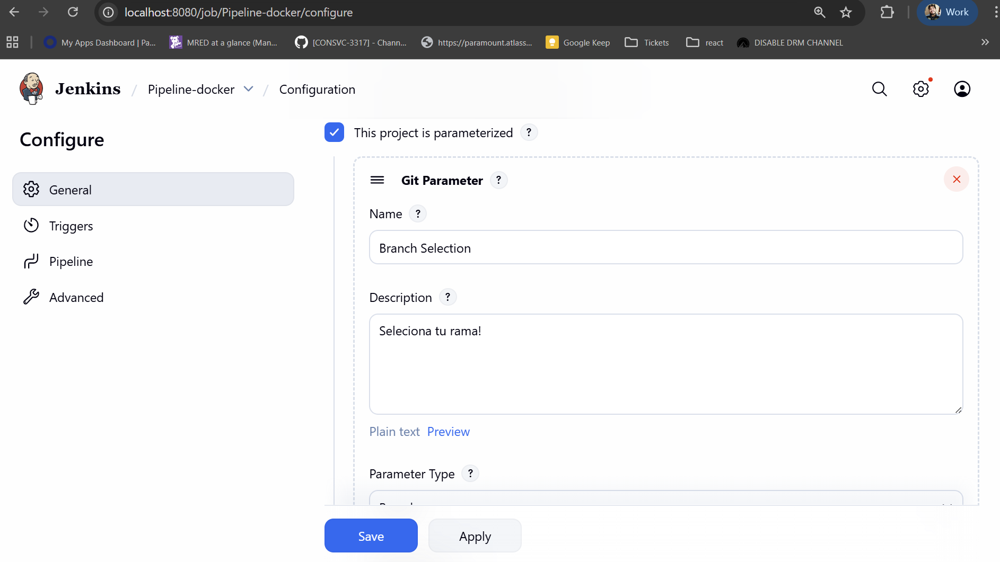
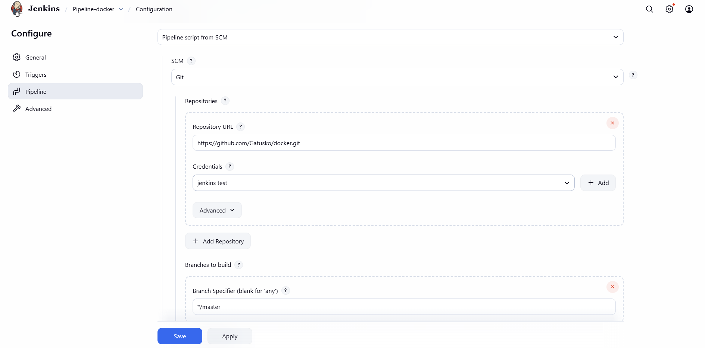

# Docker 

Docker no es una maquina virtual es la manera
que podamos correr nuestras aplicaciones dentro
de un contenedor. 

Docker solo funciona en Linux ya que maneja su 
kernel y es por eso que podemos utilizar N Imagenes.

Dentro de este contenedor esta aislado totalmente de
la maquina que esta corriendo. Eso es lo que lo hace 
algo bien poderoso. 

## Maquina Virtual vs Docker 
Antes(Se sigue usando) para hostear una aplicacion y hacerlo distrubuido
se obtana por maquinas virtuales en donde tenias virtualizadores.

En Windows el mas usado el *Hyper-v* Pero hay mas conocidos y tienen
su grado de complejidad que se manejan por typos. 

Docker al no ser una maquina virtual en ves corre dentro de un contenedor
dentro del mismo HOST. Estos contenedores no lo invento Docker existia 
de mucho mas antes. Solo que Docker pudo explotarlo a lo mas. 

En una explicacion de pizarra va a ser mas notorio esto. Pero 
un contenedor es NAMESPACES+CGROUPS(Control Groups)


### Instalacion de Docker 

Toda la documentacion se encuentra en este
[https://docs.docker.com/engine/install/debian/#install-using-the-repository](Link)
para la forma mas facil de instalar. Esto es con debian pero tambien 
se puede usar en otros distros

En resumen se necesita aniadir los repositorios:

```bash
# Add Docker's official GPG key:
sudo apt-get update
sudo apt-get install ca-certificates curl
sudo install -m 0755 -d /etc/apt/keyrings
sudo curl -fsSL https://download.docker.com/linux/debian/gpg -o /etc/apt/keyrings/docker.asc
sudo chmod a+r /etc/apt/keyrings/docker.asc

# Add the repository to Apt sources:
echo \
  "deb [arch=$(dpkg --print-architecture) signed-by=/etc/apt/keyrings/docker.asc] https://download.docker.com/linux/debian \
  $(. /etc/os-release && echo "$VERSION_CODENAME") stable" | \
  sudo tee /etc/apt/sources.list.d/docker.list > /dev/null
sudo apt-get update
```

Instalar docker

```bash
sudo apt-get install docker-ce docker-ce-cli containerd.io docker-buildx-plugin docker-compose-plugin
```

Una ves instalado verificamos la instalacion 

```bash
sudo docker run hello-world
```

En algunos distros como ubuntu para correr sin sudo es aniadir el grupo
y aniadir ese usuario al grupo de docker. Realmente a mi me sirve 
estos comandos
```bash
sudo groupadd docker
sudo gpasswd -a $USER docker
```

### Dentro de un Contendor 

Tenemos muchas imagenes de Docker en docker hub:
https://hub.docker.com/

Aca vamos a correr un distro de Debian:

https://hub.docker.com/_/debian


Con el comando:

```bash
docker container run -it debian:trixie-backports
```

Flags:

`-i --interactive Nos deja correr un comando` https://docs.docker.com/reference/cli/docker/container/run/#interactive

`-t --tty pseudo-tty (terminal)` https://docs.docker.com/reference/cli/docker/container/run/#tty

Con esto vamos a tener este resultado:

```bash
mike@Mike-Laptop:/mnt/c/Users/Michael Ramirez
$docker run -it debian:trixie-backports
root@d6c16222bc1f:/#
```
Y ya estamos dentro de nuestro contendor Debian. 

Correremos el comando de matar a todo:

```bash
root@9df163ef30ba:/# rm -rf ./*
```

Veremos que ese contenedor ya no funciona pero podemos 
correr otro contenedor para que si funcione y obtener 
todo. 

### Como funciona Docker??
En realidad tiene una capa HTTP/REST en donde se puede
comunicar para obtener la informacion 

Pot ejemplo:

```bash
curl --unix-socket /var/run/docker.sock http://localhost/v1.47/containers/json
```

Nos va a dar esta informacion y la documentacion oficial se encuentra
https://docs.docker.com/reference/api/engine/

No es bueno saber diggear esto si no te quieres especializar en devops 
pero con esto puedes hacer tus propios dashboards.

### Creando tus propias Imagenes 

Bueno vimos lo basico de Docker. Pero es hora de crear nuestras propias Imagenes!
Pero que es una Imagen?

Una Imagen es un paquete que incluye todas las imagenes, binaries, librerias
y configuracion para correr un contenedor! 

No lo digo yo. Lo dice la Documentacion

https://docs.docker.com/get-started/docker-concepts/the-basics/what-is-an-image/

Y cada imagen tiene Layers

Que es un Layer: 

Representa los cambios para aniadir, remover o modificar archivo. 


Vamos a ir paso por paso. 

Dependiendo de tu aplicacion o uso ya existe imagenes base.


| Lenguaje | Imagen Base                       |
|----------|-----------------------------------|
| Go       | https://hub.docker.com/_/golang   |
| Java     | https://hub.docker.com/_/openjdk  |
| JS       | https://hub.docker.com/_/node     |

Siempre es aconsejable usar las imagenes oficiales pero podemos crear si 
nosotros queremos que sea mas pequenio nuestro contenedor. 

Muy bien manos a las obras con Go!

## Tabla de Docker Image 

Para tener la full documentacion de los comandos
https://docs.docker.com/reference/dockerfile/#overview
esta es la pagina en donde tendremos mas detallado la informacion

| COMANDO     | DESCRIPCION                                                                                                                           |
|-------------|---------------------------------------------------------------------------------------------------------------------------------------|
| `FROM`      | Crear la imagen basado en una imagen                                                                                                  |
| `WORKDIR`   | En donde vamos a trabajar. Si tenemos multiples workdir<br/> entonces aniade otra directory sobre el mismo                            |
| `COPY`      | `COPY <SRC> <DST>` Copiamos informacion necesaria a nuestra imagen y workdir                                                          |
| `RUN`       | Ejecutamos un comando! Esto es basada en la imagen por ejemplo en la imagen de go. Tenemos go instalado<br/> entonces lo podemos correr |
| `CMD`       | Es un ejecutable que solo puede existir una sola ves. Este puede ser lo que inicia nuestra aplicacion y puede ser override            |
| `ENTRYPOINT` | Es lo que se ejecuta una ves que se inicia nuestro contendor solo puede ser usado solo una ves.                                       |


## Comandos para imagen

```bash
docker image build --tag <name>:<tag> . 
```

El punto siginifica el directorio actual. Tambien se puede seleccionar 
el archivo con el flag -f.

Tambien al no especificar un tag tendriamos que correr por id. Es por 
eso siempr espcificar el Tag Name nos servira mucho en adelante

```bash
# Comando para hacer correr en un path especifico 
docker image build --tag <name>:<tag> -f <path> .
```

Ejemplos: 


```bash
# Para poder crear por defecto el DockerFile
docker image build --tag test:1.0.0 .
```

```bash
# Para poder selecionar un dockerfile especifico. 
docker image build --tag test:2.0.0 -f Dockerfile-scratch .
```

El punto quiere decir usa el directorio actual!! 


```bash 
# listar toda nuestras images
docker image ls
```


```bash
# para poder eliminar las imagenes
docker image prune
```

```bash
# para poder elminar las imanges
docker image prune --all 
```

Esto es para eliminar imagenes que no se estan usando. 

ATENCION!! Si tienes algun contenedor que fue detenido o usado 
este no va a eliminarse de docker hay que ver si esta detenido


```bash
docker container prune 
```

## Corriendo nuestros contenedores 

Una ves que creamos nuestras imagenes tenemos algo muy importante
Correr los contenedores. 

Antiguamente se usaba sin prefijos lo pueden ver este Pull Request
que eso ya fue deprecated 

https://github.com/moby/moby/pull/26025

Entonces para ver que contenedores estan corriendo

```bash 
## Para ver que contendor ACTUAL esta corriendo 
docker container ps 
```

```bash
## Para ver que contenedor estan corriendo y cuales fueron detenidos 
docker container ps -all
```

Y vamos a ver el comando para mi mas importante de Docker.

```bash
docker container run 
```

Es extensa la docuemntacion https://docs.docker.com/reference/cli/docker/container/run/
Pero vamos a ver lo mas importante.

En RESUMEN *crea y corre* un nuevo contenedor con los valores asignados. 


* Puertos 
* Nombre 
* Imagen Especifica 
* detatch o no

Vamos por ejemplo 

```bash
docker container run --name test -p 8080:8080 test:5.0.0
```

Al correr este comando veremos que tenemos nuestro contenedor corriendo
y podemos accederlo. 

Ahora aqui hay algo muy importante al salir y tratar el mismo comando nos 
saldra un error. Ya que el comando `docker container run` CREA Y CORRE. 

Al existir un contenedor con el mismo nombre tendremos que ejecutar 

Esto tambien quiere decir que va a tener por defecto el puerto abierto 
en 8080

```bash
docker container start test 
```

Esto hara correr el contenedor por defecto en detatch mode 

```bash 
docker container start -a test 
```

Con esto estaria modo attach y estara en nuestra consola.

Pero que pasa si queremos subir la version de nuestro contenedor? 

Esto es un caveat que muchos juniors terminan teniendo muchos 
contenedores con diferentes nombres. 


```bash
docker container run --name test -p 8080:8080 test:6.0.0
```

Nos va a salir un error ya que existe el contenedor con el nombre 
`test`

Entonces tendremos que:

* Eliminar el contenedor con nombre test 
```bash
docker container rm test
```

* Correr docker run con la nueva version 
```bash
docker container run --name test -p 8080:8080 test:6.0.0
```

Ya adelante veremos como manejar esto mediante `docker compose`

| Commando                                                                         | Proposito                                                     |
|----------------------------------------------------------------------------------|---------------------------------------------------------------|
| `docker container --name <containerName> -p 8080:8080 run <imageanme>:<tagName>` | Crear un contenedor con nombre y puerto especifico            |
| `docker container ps` `docker container ls`                                      | Ver los contenedores corriendo                                |
| `docker container ps --all` `docker container ls --all`                          | Ver todo los contenedores incluso los detenidos               |
| `docker container start <containerName>`                                         | Iniciar un contenedor ya creado                               |
| `docker container rm <containerName>`                                            | Remover un contenedor                                         |
| `docker container prune`                                                          | Eliminar todo los contenedores que no estan siendo utilizados |


## Docker Compose 
Vimos un poco tedioso estar eliminando y creando contenedores cada ves
queremos subir de version. Por eso viene algo que nos ayuda muchisimo
`docker compose` conocido antiguhamente como `docker-compose` pero 
esto ya fue deprecated y vamos a usar la ultima version. 

Docker compose son .yaml file en donde tiene todas las caracteristicas
de nuestro 

### Instalacion 

Con ubuntu corremos los comandos para instalarlo 

```bash
sudo apt-get update
sudo apt-get install docker-compose-plugin
```

Una ves instalados ya tenemos lo que que queremos

```
docker compose
```

### Yaml files 

En version anteriores al correr `docker-compose up -d` buscaba
por defecto el `docker-compose.yml` file pero ahora podemos 
definirlo como `compose.yml` file 

#### Capa de Servicios

Al usar la ultima version no necesitamos especifacar versiones o 
nada por el estilo. 

Vamos a traducirlo nuestro comando
```bash
docker container run --name test -p 8080:8080 test:1.0.0
```

```yaml
# Definimos nuestros servicios
services:
  # Definimos el nombre del servicio
  my-service:
    # La Imagen que va a usar
    image: test:1.0.0
    # El puerto
    ports:
      - 8080:8080
```

Una ves definido nuestro `compose.yml` corremos

`docker compose up`

Y podremos ver que esta corriendo bien. Para correrlo como detatch mode

`docker compose up -d`

Y tendra corriendo perfectamente.

`docker compose down` 

Bajara todo nuestros contendores

`docker compose ps`

para ver si algun contenedor de nuestro compose esta corriendo.

`docker compose start`

Corre los contenedos que ya fueron creados. 

`docker compose -f compose-v2.yml up`

Selecionamos un file especifico.

Nuestro compose file es donde ya comenzamos a tener realmente un poco mas
de control. 

Vamos a tener el `compose-v3.yml` en donde definimos a mas detallo muchas cosas.


# Volumes en Docker Statefull 

Hasta ahora todo nuestros servicios fueron *stateless* es decir 
que no tiene un estado entre requests y demas. No guarda, no tiene
memoria y demas es un servicio sin ningun estado guardado. 


## Volumenes en DockerFile (anonimos)
Pero a veces necesitamos que nuestros servicios tengan un estado 
o guarden archivos. En este ejemplo de docker-image vamos a crear 
un volumen dentro de la imagen


```bash
docker image build --tag test:volume -f Dockerfile-volume .
```

Nuestro archivo `Dockerfile-volume` esta definiendo un VOLUMEN
que va a ser anonimo. Eso quiere decir que Docker va a manejar este volumen
y va a tener la manera de correrlo vamos a correr esto.

Dentro de la imagen tenemos:

```dockerfile
# Creamos un directorio que no va a ser anonimo
RUN mkdir "/data"

# CREAMOS UN VOLUMEN Y ESTE VOLUMEN va a ser anonimo
VOLUME ["/data"]
```

Un volume y veremos que este se creara. Usar este typo de volumen
anonimo es bueno para las base de datos o demas para que el usuario no 
pueda interferir con los valores.

Si nosotros corremos 

```bash
docker volume ls
```
Veremos que se crea con un numero randomico 

si nosostrons hacemos un inspect al container creado veremos cual 
es este lugar

```bash
docker container inspect docker-my-service-1
```

Podremos donde esta guardada la informacion. Y si modificamos este archivo
veremos que pasa. 

## Volumenes a nivel docker-compose o cli VOLUME BIND

En este escenario no vamos a crear un volumen anonimo es mas 
vamos a darle el nombre esto se hace mas facil cuando corramos
dentro del contenedor docker-compose

```bash
docker image build --tag test:volume-on-compose -f Dockerfile-volume-on-compose .
```

Iniciamos el contenedor


```bash
docker compose -f compose-volume-on-compose.yml up
```

Si nosotros corremos el comando

```bash
docker volume ls
```

Veremos que esta por defecto el volumen creado. 

```bash
sudo ls /var/lib/docker/volumes/docker_mi-volumen/_data/
```

Para ver la informacion. 

Aqui docker sigue teniendo el control de nuestros volumenes.
Es mas facil debuggear y si necesitamos cambiar la informacion aqui
es necesario.

### Paso para aniadir un usuario 

Vimos en los anteriores ejemplos que tuvimos que usar sudo 
y demas para ver en esta parte vamos aniadir a un usuario 
y usarlo como rootless. 

```bash
docker image build --tag test:volume-with-user -f Dockerfile-volume-with-user .
```

Y hacemos correr

```bash

```

Dentro de aca veremos muchos problemas que causa el dolor de cabeza
de corrrer como rootless. Primero docker siempre va a manejarlo todo
como root si no cambias el usuario. Y al ser como root los demas no
van a poder crear o modificar este escenario.

Vamos a crear nuestro directorio:

```bash
sudo mkdir /home/miusuario/rootles
sudo chmod 775 /home/miusuario/rootles/
sudo chown 1001:1001 /home/miusuario/rootles/
sudo chmod g+s /home/miusuario/rootles/
```

Con esto tiene el mismo grupo pero nuestro usuario no va a 
tener permiso. El problema aca es que en *LINUX* solo un grupo puede
ser el duenio de la carpeta. Claro se puede aniadir permisos y demas
a otros grupos sin embargo eso es complicarse. 

La solucion? 

Un usuario para docker, un grupo para docker. 
O que el usuario del host machine este en el grupo que creaste.
Es cuestion de como vas a deployar esto. 


```bash
sudo addgroup --gid 1001 migrupo
sudo adduser -uid 1001 --disabled-password --gecos "" --ingroup migrupo miusuario
```

Con esto tendremos el usuario y el grupo. Pero si no queremos el usuario
entonces tenemos que aniadir al usuario del host al grupo de 1001 

```bash
sudo gpasswd -a mike migrupo
```


## Jenkins y Docker

Jenkins es una de las herramientas mas usadas para CI/CD esto nos ayuda para hacer nuestros 
builds mas facil y demas.


Vamos a crear nuestra propia imagen de Jenkins con los plugins necesarios 


```bash
docker image build -f Dockerfile-jenkins .
```

Source de los plugins de Jenkins:

https://updates.jenkins.io/latest/

Y hacemos correr nuestro Jenkisn 

```bash 
docker compose -f compose-jenkins.yml up
```

### Pasos para integrar Docker-Jenkins-Github


Configuramos para que podamos acceder a nuestro github podemos aniadir los
host como ignorarlos en este escenario vamos a ignorarlos
:



Creamos nuestro primer pipeline 



Una ves creado nuestro primer pipeline vamos a seleccionar nuestra rama para 
poder hacer el build



Seleccionamos y aniadimos nuestras credenciales:



prueba